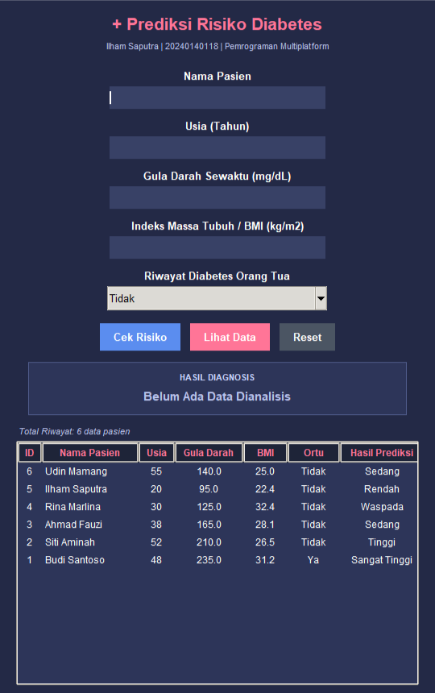
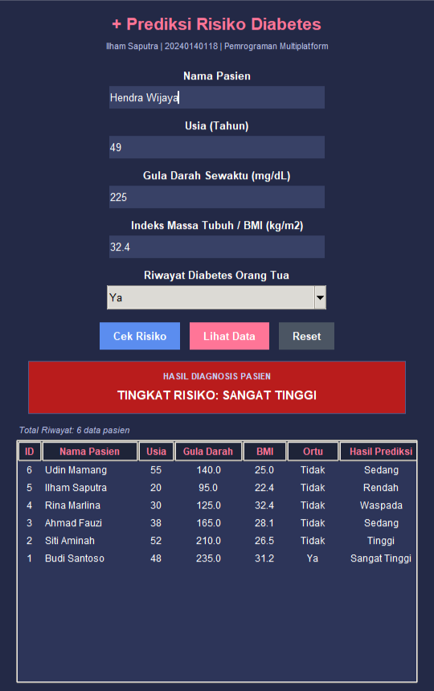
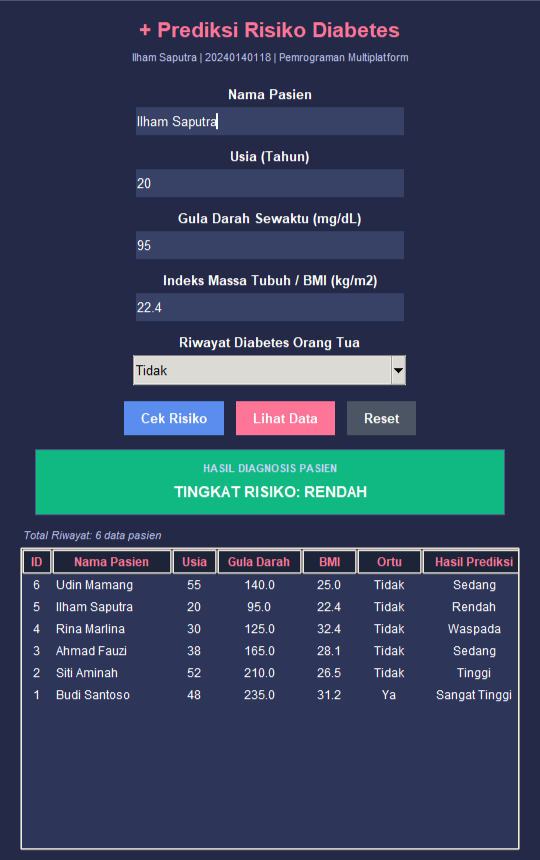
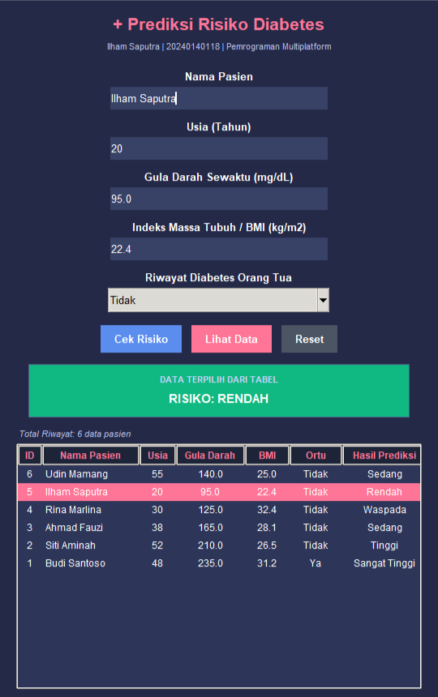
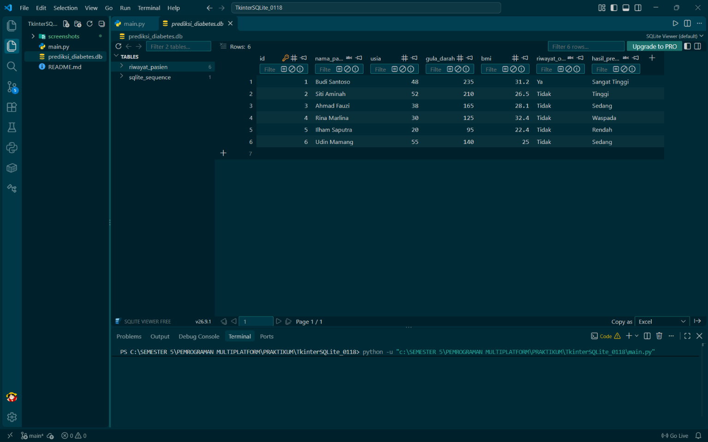

# Aplikasi Prediksi Risiko Diabetes (Tkinter + SQLite)
**Tugas Praktikum Pemrograman Multiplatform (Topic 7)**

- **Nama**: Ilham Saputra
- **NIM**: 20240140118
- **Kelas**: D
- **Mata Kuliah**: Pemrograman Multiplatform

## Deskripsi Proyek
Aplikasi desktop berbasis Python Tkinter untuk memprediksi tingkat risiko diabetes pasien berdasarkan parameter medis (kadar gula darah, BMI, usia, dan riwayat diabetes orang tua), terintegrasi langsung secara permanen dengan basis data lokal SQLite (`prediksi_diabetes.db`).

## Fitur Utama Sistem
1. **Formulir Validasi Medis**: Validasi input nama, usia, gula darah, BMI, dan combobox riwayat orang tua.
2. **Business Logic Klasifikasi 5 Kondisi**: Penentuan risiko (Sangat Tinggi, Tinggi, Sedang, Waspada, Rendah) dengan indikator visual warna dinamis.
3. **Penyimpanan Permanen SQLite**: Penyimpanan riwayat pasien dengan parameterized queries aman dari SQL Injection.
4. **Tabel Interaktif `ttk.Treeview`**: Penampil riwayat pasien dengan event listener `<<TreeviewSelect>>` untuk memuat ulang data ke formulir saat baris diklik.
5. **Tombol Reset Formulir**: Mengosongkan form input dan mengembalikan status sistem ke awal.

## Tangkapan Layar Aplikasi
| Form Awal & Riwayat Pasien | Hasil Diagnosis Risiko Sangat Tinggi |
| :---: | :---: |
|  |  |

| Hasil Diagnosis Normal / Rendah | Event Klik Baris Tabel (TreeviewSelect) |
| :---: | :---: |
|  |  |

### Basis Data SQLite

###FULLL

